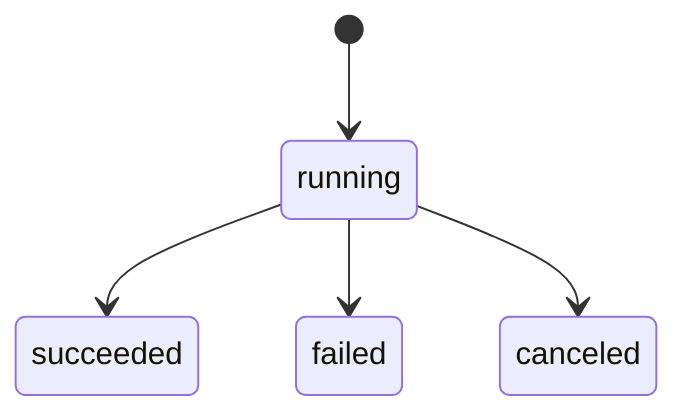

# Architecture

Scope: how Foreman's parts (queue, scheduler, workers, council, gate, board) fit together. For a contributor reading the code. For running Foreman, see [OPERATING.md](OPERATING.md); for the ticket lifecycle in prose, see [lifecycle.md](lifecycle.md).

`node scripts/checks/arch-truth.ts` (run by `npm run verify`) fails when a backticked repo path below does not exist, when a `src/` file over 500 lines is not named here, or when the state names in the diagrams differ from `src/types.ts`.

## Module map

Foreman is one Node process: an HTTP server and a scheduler loop over one SQLite file. Every file in `src/` over 500 lines is named here.

| File | What it holds |
| --- | --- |
| `src/scheduler.ts` | The tick loop: claims queued tasks, runs a worker per task, moves it through verify, parks it for approval. Owns the run's check and the retry rules. |
| `src/queue.ts` | The store: every write to the ledger tables, the task status funnel (`setStatus`), dependencies, epics, repairs, schedules, memory, caches. |
| `src/debrief.ts` | Builds the per-ticket debrief (`<id>.md` and `<id>.json`) from the ledger. |
| `src/cli.ts` | The `foreman` command: argument parsing and every subcommand. |
| `src/verify/crewReview.ts` | The reviewer chain that reads a run's diff and returns a verdict and follow-ups. |
| `src/gate.ts` | The human gate: approve and reject, and landing the approved change. |
| `src/server.ts` | The HTTP API and the static board. |
| `src/assistant/crewPlan.ts` | Turns an ask into a planned epic of tickets. |
| `src/models.ts` | The model roster: aliases, specs, the model-plane config. |
| `src/verify/council.ts` | The advisory council: several model opinions and a chair verdict. |
| `src/isolate.ts` | The jail: a git worktree per run, and the record of what the run changed. |
| `src/runners/proctree.ts` | Reads the process table so a run's whole process tree can be found and stopped. |
| `src/skills.ts` | Skills a role may carry, and their per-ticket limits. |
| `src/db.ts` | The SQLite schema and its migrations. |
| `src/verify/assertionCheck.ts` | Compares a run's test assertions with the base to catch weakened tests. |
| `src/verify/revertTests.ts` | Runs the new tests against the reverted change to show they fail without it. |
| `src/playbooks.ts` | Loads playbooks (roles and their modes) and checks their skill lists. |
| `src/prose/metrics.ts` | Prose measurements (sentences, length) for non-code tickets. |
| `src/prose/tics.ts` | Prose tic detection for non-code tickets. |
| `src/verify/revertCheck.ts` | Decides whether a change is code or documentation for the revert check. |
| `src/assistant/planCheck.ts` | Checks a plan before it is queued. |
| `src/runners/cliRunners.ts` | Runs the external model CLIs as workers. |
| `src/backup.ts` | Daily database backup and restore. |

Boundaries:

- **One writer for the ledger.** Code outside `src/queue.ts` reads the tables through `store.db`; the few exceptions are listed under each table below.
- **The jail is separate from the repo.** A run works in a worktree under `<FOREMAN_HOME>/work/`, never in the target repo. `src/isolate.ts` makes it and reports what changed; `src/merge.ts` lands an approved change.
- **Runners are interchangeable.** `src/runners/` holds the API runner, the CLI runners and the shell runner behind one interface; the scheduler does not know which it has.
- **Verification is its own lane.** `src/verify/` (tests, council, crew review, assertion and revert checks) runs after a worker finishes, in a lane with its own limit (`maxVerifying` in `src/config.ts`).
- **The security code is guarded.** `src/security/` holds the sandbox, the admission scan and the core guard; see [Protected paths](#protected-paths).
- **The board is static files.** `board/` is plain HTML, CSS and JS served by `src/server.ts`; it holds no state of its own.

## Database tables

The schema is in `src/db.ts`. Writers were found by searching `src/` for the SQL that changes each table.

| Table | Written by |
| --- | --- |
| `tasks` | `src/queue.ts` (create, status, repairs, assignee, gate, archive stamp, delete); `src/skills.ts` sets its `skills` column |
| `task_deps` | `src/queue.ts` (inserted when a task is created) |
| `runs` | `src/queue.ts` (start, stage, progress, usage, finish); `src/db.ts` fills the `decision` label on existing rows when it migrates |
| `events` | `src/queue.ts` (`record`, delete with a task); `src/scheduler.ts` prunes old rows |
| `artifacts` | `src/queue.ts` |
| `verdicts` | `src/queue.ts` (insert; retention delete) |
| `receipts` | `src/queue.ts` (insert; retention delete) |
| `memory` | `src/queue.ts` |
| `council_cache` | `src/queue.ts` |
| `crew_review_cache` | `src/queue.ts` |
| `schedules` | `src/queue.ts` |
| `settings` | `src/queue.ts` |
| `red_repos` | `src/queue.ts` |
| `shadow_verdicts` | `src/queue.ts` |
| `archive` | `src/queue.ts` (folds a closed task into a summary row) |
| `decisions` | `src/queue.ts` (insert only; a trigger in `src/db.ts` stops `INSERT OR REPLACE` overwriting a row) |

`src/backup.ts` replaces the whole database file on restore; it does not write rows.

## Task and run states

The task states are the `TaskStatus` union in `src/types.ts`. Every change goes through `setStatus` in `src/queue.ts`, except a few raw updates in the same file (claiming a task, reopening an epic, a restart requeue). `done`, `failed`, `rejected` and `canceled` are terminal; a retry or a repair round can still move a task out of them.

```mermaid
stateDiagram-v2
  [*] --> queued
  [*] --> blocked
  [*] --> awaiting-human
  blocked --> queued
  blocked --> awaiting-human
  blocked --> failed
  queued --> running
  running --> verifying
  running --> queued
  running --> awaiting-human
  running --> awaiting-approval
  running --> failed
  verifying --> awaiting-approval
  verifying --> queued
  verifying --> failed
  awaiting-approval --> done
  awaiting-approval --> rejected
  awaiting-approval --> queued
  awaiting-human --> queued
  awaiting-human --> done
  failed --> queued
  failed --> blocked
  queued --> canceled
  blocked --> canceled
  running --> canceled
  awaiting-approval --> canceled
  awaiting-human --> canceled
  done --> [*]
  rejected --> [*]
  canceled --> [*]
```

Reading it:

- A new task starts `blocked` while a dependency is open, `awaiting-human` when it is assigned to the operator, otherwise `queued`.
- `blocked` becomes `queued` when every dependency is `done`, and `failed` when one ends badly.
- `running` goes back to `queued` after a failed attempt with attempts left, and to `failed` when none are left.
- `awaiting-approval` is where a person decides. A change that cannot be landed also returns the task there. Core-guard holds and budget hard-stops park a task there too.
- A repair round or a manual retry moves a task out of `awaiting-approval` or `failed` back to `queued` (or to `blocked` while it waits on dependencies).

Runs have their own, smaller status: the `status` field of `Run` in `src/types.ts`. A run is created `running`. Its stage (`admit`, `isolate`, `plan`, `work`, `test`, `verify`, `gate`; the `STAGES` list in `src/types.ts`) is separate from its status. A daemon restart marks runs still `running` as `canceled`.



## The FOREMAN_HOME layout

`<FOREMAN_HOME>` is the `FOREMAN_HOME` environment variable, or `~/.foreman`. It is resolved once in `src/config.ts`. Paths the code builds under it:

```text
<FOREMAN_HOME>/foreman.db             the ledger (FOREMAN_DB moves it)
<FOREMAN_HOME>/daemon.pid             the one-daemon lock, created exclusively (src/lock.ts)
<FOREMAN_HOME>/work/<runId>/          one jail (git worktree) per run
<FOREMAN_HOME>/artifacts/<runId>.log  the run's full log
<FOREMAN_HOME>/artifacts/<runId>.diff the run's diff
<FOREMAN_HOME>/artifacts/<runId>.report.md, <runId>.assertions.json, <runId>.revert-tests.json   verification output
<FOREMAN_HOME>/traces/YYYY-MM-DD.jsonl  daily trace files, kept FOREMAN_TRACE_RETAIN_DAYS days
<FOREMAN_HOME>/backups/               database backups (FOREMAN_BACKUP_DIR moves it)
<FOREMAN_HOME>/debriefs/<id>.md, <id>.json   debriefs
<FOREMAN_HOME>/claude-config/         the claude worker's own config directory (FOREMAN_CLAUDE_CONFIG_DIR moves it)
<FOREMAN_HOME>/playbooks/             playbooks (FOREMAN_PLAYBOOKS_DIR moves it)
<FOREMAN_HOME>/agents/                agent definitions (FOREMAN_AGENTS_DIR moves it)
<FOREMAN_HOME>/personas/              personas (FOREMAN_PERSONAS_DIR moves it)
<FOREMAN_HOME>/align/                 alignment data (FOREMAN_ALIGN_DIR moves it)
<FOREMAN_HOME>/deps-cache/            cached dependency installs
<FOREMAN_HOME>/models.json            model roster overrides
<FOREMAN_HOME>/bench.json             benchmark results
<FOREMAN_HOME>/tool-state.json        forged-tool usage and quarantine state
<FOREMAN_HOME>/.sandbox-selftest      marker written by the sandbox self-test
```

The forged-tool catalog is not under the home: it is `toolbox/` in the repo (`FOREMAN_TOOLBOX` moves it), so it can be tracked in git.

Not every entry exists on a fresh install: the module that uses a path creates it, so this list is where the code writes, not a promise that all are present.

## Protected paths

`PROTECTED_PATHS` in `src/security/coreGuard.ts` lists the files a self-improvement run may not change:

- `src/security/`
- `src/improve.ts`
- `src/merge.ts`
- `src/isolate.ts`
- `src/tools/catalog.ts`
- `src/lock.ts`
- `src/gate.ts`
- `src/scheduler.ts`
- `src/queue.ts`
- `src/server.ts`
- `src/db.ts`
- `src/daemonGuard.ts`
- `test/improve.test.ts`
- `test/security-guard.test.ts`

Why they are guarded, from the comment above the list:

- **They define what Foreman may do.** The security scanner and the guard itself, the landing check (`src/merge.ts`), tool registration (`src/tools/catalog.ts`), the jail (`src/isolate.ts`, which says what a run changed), the lock, and the tests that pin the guard. A change that widened these would widen Foreman's own permissions.
- **They hold the rules around the guard.** The gate, the scheduler's check, the queue's reopen path, the HTTP API and the store's schema. The approve endpoint takes no proof of who is calling, so a process a run left behind could approve its own ticket; "a person approves it" alone does not keep a worker's change out of these files.

A ticket may change a protected path only if it carries `allowCore`, which Foreman never sets on its own.

What this does not do: the list is matched on paths in the change, so it does not stop a person editing these files by hand, and it does not cover files outside the list that these files depend on.
