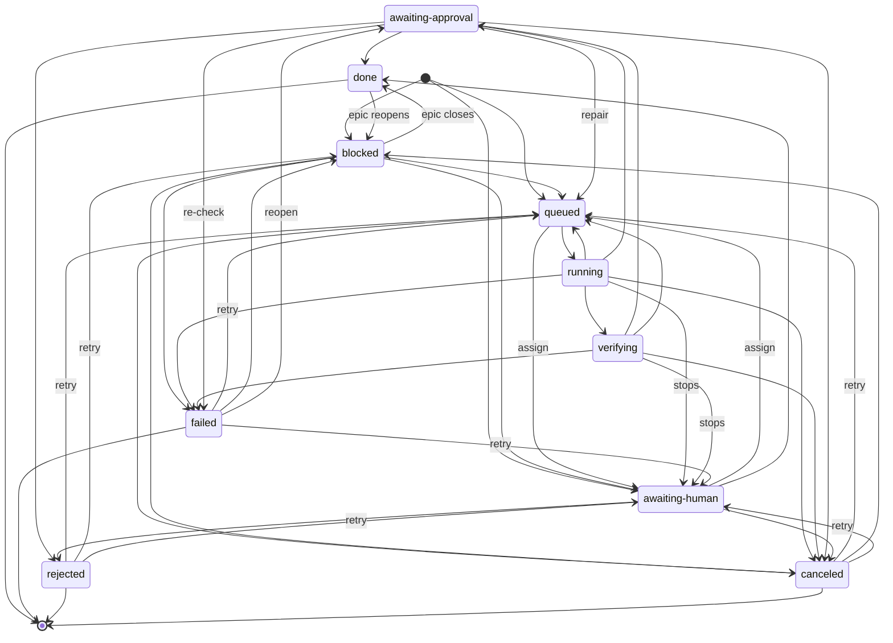
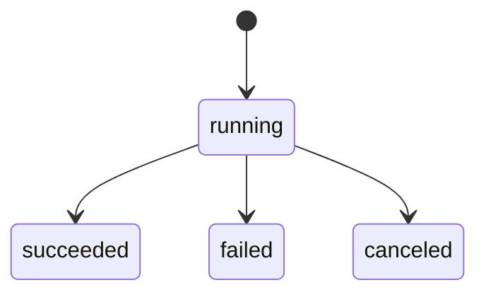

# Architecture

Scope: how Foreman's parts (queue, scheduler, workers, council, gate, board) fit together. For a contributor reading the code. For running Foreman, see [OPERATING.md](OPERATING.md); for the ticket lifecycle in prose, see [lifecycle.md](lifecycle.md).

`node scripts/checks/arch-truth.ts` (run by `npm run verify`) fails when a backticked repo path below does not exist, when a `src/` file over 500 lines is not named here, or when the state names in the diagrams differ from `src/types.ts`.

## Module map

Foreman is one Node process: an HTTP server and a scheduler loop over one SQLite file. Every file in `src/` over 500 lines is named here.

| File | What it holds |
| --- | --- |
| `src/scheduler.ts` | The tick loop: claims queued tasks, runs a worker per task, moves it through verify, parks it for approval. Owns the run's check and the retry rules. Each tick stage (schedules, archive sweep, asks, improvements, gates, reconcile, the dispatch gate, dispatch, re-checks, red re-checks, dirty probes) runs in that order inside its own try/catch: a stage that throws is recorded as `scheduler tick failed in <stage>: ...` (rate-limited per stage), counted in `tickStageErrors()`, and the later stages still run. Each stage is timed too (`tickStageMs()`, the stage order is `TICK_STAGES`), for `GET /api/metrics`. A throwing dispatch gate defers dispatch and the stages after it, as a gate that says no does. A throwing dispatch does not: the gate found free slots, so the re-check and probe stages still get them that tick. An operator's dispatch hold (`dispatchHold`, `foreman hold`) skips only the dispatch stage; shutdown's `pauseDispatch` returns before every stage. |
| `src/queue.ts` | The store: every write to the ledger tables, the task status funnel (`setStatus`), dependencies, epics, repairs, schedules, memory, caches. |
| `src/debrief.ts` | Builds the debrief of a finished epic or ticket (`<id>.md` and `<id>.json`) from the ledger, traces and run logs. |
| `src/cli.ts` | The `foreman` command: argument parsing and every subcommand. |
| `src/verify/crewReview.ts` | The reviewer chain that reads a run's diff and returns a verdict and follow-ups. |
| `src/gate.ts` | The approval gate, decided by a person or the owner model: approve and reject, and handing an approved change to `src/merge.ts` to land. |
| `src/server.ts` | The HTTP API and the static board. |
| `src/metrics.ts` | `GET /api/metrics`: a read-only JSON or Prometheus view of the ledger, the tick stage timings and the event loop's delay. |
| `src/assistant/crewPlan.ts` | Turns an ask into a planned epic of tickets. |
| `src/models.ts` | The model roster: aliases, specs, the model-plane config. |
| `src/verify/council.ts` | The advisory council: several model opinions and a chair verdict. |
| `src/isolate.ts` | The jail: a git worktree per run, and the record of what the run changed. |
| `src/runners/proctree.ts` | Reads the process table so a run's whole process tree can be found and stopped. |
| `src/skills.ts` | Skills a role may carry, and their per-ticket limits. |
| `src/db.ts` | The SQLite schema, its migrations and its version stamp. |
| `src/verify/assertionCheck.ts` | Compares a run's test assertions with the base to catch weakened tests. |
| `src/verify/revertTests.ts` | Runs the new tests against the reverted change to show they fail without it. |
| `src/playbooks.ts` | Loads playbooks (roles and their modes) and checks their skill lists. |
| `src/prose/metrics.ts` | Prose measurements (sentences, length) for non-code tickets. |
| `src/prose/tics.ts` | Prose tic detection for non-code tickets. |
| `src/verify/revertCheck.ts` | The revert check's helpers (a scratch tree at the base, per-file test commands, which paths are docs); `src/verify/revertTests.ts` is built on them. |
| `src/assistant/planCheck.ts` | Checks a plan before it is queued. |
| `src/runners/cliRunners.ts` | Runs the external model CLIs as workers. |
| `src/backup.ts` | Daily database backup and restore. |

Boundaries:

- **One writer for the ledger.** Code outside `src/queue.ts` reads the tables through `store.db`; the few exceptions are listed under each table below. `scripts/checks/no-raw-db.ts` holds the per-file count of raw ledger SQL (`.prepare`/`.exec` on a `.db`) and `new DatabaseSync` openers outside `src/queue.ts` and `src/db.ts`; a count may only fall, and verify prints the raw writes (0) and the writable openers (1: `openLedgerForReceipt`) still outside the queue.
- **The jail is separate from the repo.** A run works in a worktree under `<FOREMAN_HOME>/work/`, never in the target repo. `src/isolate.ts` makes it and reports what changed; `src/merge.ts` lands an approved change.
- **Runners share one interface.** `src/runners/` holds the API runner, the CLI runners, the shell runner and the echo (demo) runner behind the `Runner` interface in `src/runners/index.ts`. The scheduler goes by each runner's declared traits (`takesBrief`, `verifiable`) and names a runner only for a few things: `claude-code`'s session resume, provider-limit hold, agent settings and shell allowlist, and the api runner's tool brief.
- **Verification is its own lane.** `src/verify/` (tests, council, crew review, assertion and revert checks) runs after a worker finishes, in a lane with its own limit (`maxVerifying` in `src/config.ts`).
- **The security code is guarded.** `src/security/` holds the sandbox, the admission scan and the core guard; see [Protected paths](#protected-paths).
- **No import cycles.** `test/architecture.test.ts` fails on any cycle of value imports in `src/` (`CYCLES` is empty) and on any edge out of `src/security/` beyond config, types, `src/localOnly.ts` and `src/gitTimeout.ts` that `SECURITY_EDGES` does not list with its reason (one today: the core guard takes `driverlessEnv` from `src/gitExec.ts`). The pinned git lives in `src/gitExec.ts`, which imports no protected module, so the jail (`src/isolate.ts`) and the core guard both import it rather than each other.
- **Alignment and prose sit behind a fixed set of edges.** The rest of `src/` reaches `src/align/` and `src/prose/` only through the value imports listed, each with its reason, in `ALIGN_PROSE_EDGES` in `test/architecture.test.ts`; a new edge, or a listed one that is gone, fails the test until the list changes in the same diff. The scheduler imports nothing from `src/align/`: what alignment adds to the daemon (starting the adopted persona servers, and holding new work while the local-model lock is held) is an `Extension` (`src/extensions.ts`) that `src/align/extension.ts` defines and `foreman serve` registers. An extension's `onStart` runs once when the scheduler starts, not awaited, and a failure is recorded as a warning; its `dispatchHold` is read every tick, pauses dispatch while it holds, and is recorded once when it starts and once when it lifts.
- **No runtime dependencies.** `package.json` lists no `dependencies`, `optionalDependencies` or `peerDependencies`, and every `src/` value import is relative or a `node:*` built-in; `test/architecture.test.ts` fails naming the field or the file and specifier. Tooling goes in `devDependencies`.
- **The environment is read in known places.** `ENV_READS` in `test/architecture.test.ts` lists the `FOREMAN_*` names each file outside `src/config.ts` reads, and `PROCESS_ENV_FILES` lists every `src/` file that references `process.env` outside a comment, `src/config.ts` and whole-environment passes to a child included. A new file or name, or a listed one that is gone, fails the test until the list changes in the same diff.
- **The board is static files.** `board/` is plain HTML, CSS and JS served by `src/server.ts`; it holds no state of its own. It reads one `/api/state` snapshot and then follows `GET /api/events?since=<id>`. A reconnect at most 500 events behind replays the missed rows; further behind, the stream sends one `event: gap` frame carrying the newest event id instead, and the board reloads the snapshot (`board/lib/store.js`).

## Database tables

The schema is in `src/db.ts`. Writers were found by searching `src/` for the SQL that changes each table.

| Table | Written by |
| --- | --- |
| `tasks` | `src/queue.ts` (create, status, repairs, assignee, gate, skills, archive stamp, delete) |
| `task_deps` | `src/queue.ts` (inserted when a task is created) |
| `runs` | `src/queue.ts` (start, stage, progress, usage, finish); `src/db.ts` fills the `decision` label on existing rows when it migrates |
| `events` | `src/queue.ts` (`record`, the end-of-run prune the scheduler asks for, delete with a task) |
| `artifacts` | `src/queue.ts` |
| `verdicts` | `src/queue.ts` (insert; retention delete) |
| `receipts` | `src/queue.ts` (insert; retention delete) |
| `memory` | `src/queue.ts` |
| `council_cache` | `src/queue.ts` |
| `crew_review_cache` | `src/queue.ts` |
| `schedules` | `src/queue.ts` |
| `settings` | `src/queue.ts` |
| `red_repos` | `src/queue.ts` |
| `landings` | `src/queue.ts` (a row per merge under way, written and deleted around the merge in `src/gate.ts`; cleared by the operator after a crash) |
| `shadow_verdicts` | `src/queue.ts` |
| `archive` | `src/queue.ts` (folds a closed task into a summary row) |
| `decisions` | `src/queue.ts` (insert only; a trigger in `src/db.ts` stops `INSERT OR REPLACE` overwriting a row) |
| `principals` | `src/queue.ts` (insert; disable stamp; never deleted) |
| `api_tokens` | `src/queue.ts` (insert by secret hash; revoke stamp) |

`src/backup.ts` replaces the whole database file on restore; it does not write rows.

## Task and run states

The task states are the `TaskStatus` union in `src/types.ts`; the diagram draws a name with a hyphen through a `state "name" as id` line, which arch-truth reads as the name. Every change goes through `setStatus` in `src/queue.ts`, except a few raw updates in the same file (claiming a task, queuing a repair round, a restart requeue). `done`, `failed`, `rejected` and `canceled` are the terminal set (`TERMINAL_STATUSES`), but not the end: a retry or a reopen moves a task out of one, and an epic container reopens when one of its tickets starts over.



Reading it:

- A new task starts `blocked` when it has dependencies (an epic container always does), `awaiting-human` when it is assigned to the operator, otherwise `queued`. `foreman assign` moves a task that has not started between `queued` and `awaiting-human`.
- `blocked` becomes `queued` when every dependency is `done`, and `failed` when one ends badly, except that a dependency a person canceled (without `--cascade`) leaves it `blocked`, waiting (`docs/lifecycle.md`). An epic container leaves `blocked` only when its tickets close it (`done`, `failed`, or `canceled` when none is left), and goes back to `blocked` when one of them starts over.
- `running` goes back to `queued` after a failed attempt with attempts left, and to `failed` when none are left. A daemon stop requeues a `running` or `verifying` task, or sends it to `awaiting-human` after repeated stops.
- `awaiting-approval` is where a person decides. A change that cannot be landed also returns the task there. Core-guard holds and budget hard-stops park a task there too.
- A repair round moves a task from `verifying` or `awaiting-approval` back to `queued`; a council re-check that confirms a fail with no repair left ends it `failed`. `foreman retry` moves a `failed`, `rejected` or `canceled` task back to `queued` (`blocked` while a dependency is open, `awaiting-human` when it is assigned to the operator), and `foreman reopen` puts a `failed` task back at `awaiting-approval`.

Runs have their own, smaller status: the `status` field of `Run` in `src/types.ts`. A run is created `running`. Its stage (`admit`, `isolate`, `plan`, `work`, `test`, `verify`, `gate`; the `STAGES` list in `src/types.ts`) is separate from its status. A daemon restart marks runs still `running` as `canceled`.



## The FOREMAN_HOME layout

`<FOREMAN_HOME>` is the `FOREMAN_HOME` environment variable, or `~/.foreman`. It is resolved once in `src/config.ts`. Paths the code builds under it:

```text
<FOREMAN_HOME>/foreman.db             the ledger (FOREMAN_DB moves it)
<FOREMAN_HOME>/daemon.pid             the one-daemon lock, created exclusively (src/lock.ts)
<FOREMAN_HOME>/daemon.log, daemon.err.log   the daemon's output when launchd runs it (the plist `foreman service` prints)
<FOREMAN_HOME>/work/<runId>/          one jail (git worktree) per run
<FOREMAN_HOME>/artifacts/<runId>.log  the run's full log
<FOREMAN_HOME>/artifacts/<runId>.diff the run's diff
<FOREMAN_HOME>/artifacts/<runId>.report.md, <runId>.assertions.json, <runId>.revert-tests.json   verification output
<FOREMAN_HOME>/traces/YYYY-MM-DD.jsonl  daily trace files, kept FOREMAN_TRACE_RETAIN_DAYS days
<FOREMAN_HOME>/backups/               database backups (FOREMAN_BACKUP_DIR moves it)
<FOREMAN_HOME>/debriefs/<id>.md, <id>.json   debriefs
<FOREMAN_HOME>/claude-config/         the claude worker's own config directory (FOREMAN_CLAUDE_CONFIG_DIR moves it)
<FOREMAN_HOME>/playbooks/             playbooks (FOREMAN_PLAYBOOKS_DIR moves it)
<FOREMAN_HOME>/agents/                agent definitions (FOREMAN_AGENTS_DIR moves it)
<FOREMAN_HOME>/personas/              personas (FOREMAN_PERSONAS_DIR moves it)
<FOREMAN_HOME>/align/                 alignment data (FOREMAN_ALIGN_DIR moves it)
<FOREMAN_HOME>/deps-cache/            cached dependency installs
<FOREMAN_HOME>/models.json            model roster overrides
<FOREMAN_HOME>/bench.json             benchmark results
<FOREMAN_HOME>/tool-state.json        forged-tool usage and quarantine state
<FOREMAN_HOME>/tool-state.json.lock   held while a process rewrites tool-state.json
<FOREMAN_HOME>/.sandbox-selftest      marker written by the sandbox self-test
<FOREMAN_HOME>/frozen/                freeze records: process groups a process stopped, so a later `foreman serve` can end them (src/runners/freezeRecord.ts)
```

The forged-tool catalog is not under the home: it is `toolbox/` in the repo (`FOREMAN_TOOLBOX` moves it), so it can be tracked in git.

Not every entry exists on a fresh install: the module that uses a path creates it, so this list is where the code writes, not a promise that all are present.

## Capacity

`scripts/bench/ledger.ts` times the ledger's hot paths (`reconcileBlocked`, `claimable`, the board snapshot, `record`) at 1k, 10k and 100k tasks; `scripts/bench/pipeline.ts` runs an epic end to end with fake workers, suite and model, with gate batching on and off. Neither is part of `npm run verify`. What they measure and the first numbers are in [capacity.md](capacity.md).

## Protected paths

`PROTECTED_PATHS` in `src/security/coreGuard.ts` lists the files a self-improvement run may not change:

- `src/security/`
- `src/improve.ts`
- `src/merge.ts`
- `src/landing/`
- `src/isolate.ts`
- `src/gitExec.ts`
- `src/tools/catalog.ts`
- `src/lock.ts`
- `src/gate.ts`
- `src/scheduler.ts`
- `src/queue.ts`
- `src/server.ts`
- `src/db.ts`
- `src/daemonGuard.ts`
- `test/improve.test.ts`
- `test/security-guard.test.ts`

Why they are guarded, from the comment above the list:

- **They define what Foreman may do.** The security scanner and the guard itself, the landing check (`src/merge.ts`) and the per-repo merge queue, the post-merge check and the forge port with its GitLab merge-request adapter (`src/landing/`), tool registration (`src/tools/catalog.ts`), the jail (`src/isolate.ts`, which says what a run changed) and the pinned git every daemon-side git call goes through (`src/gitExec.ts`), the lock, and the tests that pin the guard. A change that widened these would widen Foreman's own permissions.
- **They hold the rules around the guard.** The gate, the scheduler's check, the queue's reopen path, the HTTP API and the store's schema. The approve endpoint takes no proof of who is calling, so a process a run left behind could approve its own ticket; "a person approves it" alone does not keep a worker's change out of these files.

A ticket may change a protected path only if it carries `allowCore`, which Foreman never sets on its own.

Helpers outside the list that only protected files value-import are not guarded: a run can change what the guarded code does through them. `PROTECTED_ONLY_HELPERS` in `test/architecture.test.ts` lists them (17 today, among them `src/assign.ts`, `src/postMerge.ts`, `src/runners/index.ts` and `src/metrics.ts`); the test reads `PROTECTED_PATHS` by import, so a new protected file or directory counts with no edit to it. A new such helper, or a listed one that is gone (protected, or imported from unprotected code too), fails the test; the list may only shrink, and protecting a helper is a change to `PROTECTED_PATHS`. The same test fails when a `PROTECTED_PATHS` entry does not exist.

What this does not do: the list is matched on paths in the change, so it does not stop a person editing these files by hand, and it does not cover files outside the list that these files depend on.
